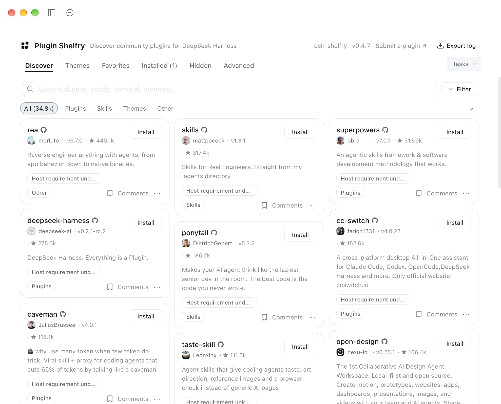
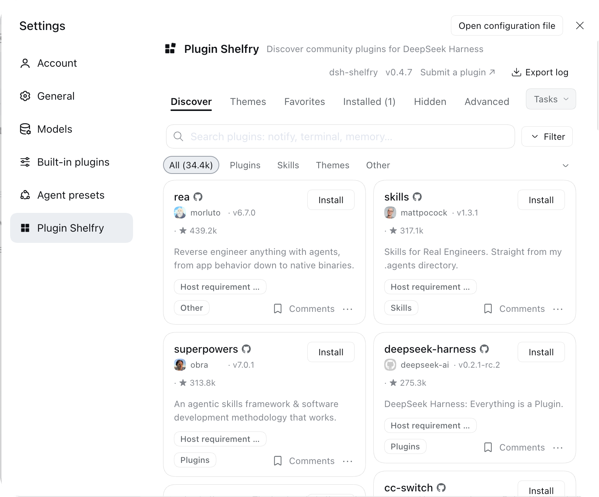

<p align="center">
  
</p>

# dsh-shelfry

English | [中文](README.zh.md)

**Plugin Shelfry**: a plugin market that lives inside DeepSeek Harness. No more
digging through GitHub topics, guessing which repos actually install, and
copy-pasting commands into a terminal — open the Plugins page, browse, read, and
install in one click.

On dsh 0.2.1+ it is a tab on the **Plugins** page next to **Installed**; older
hosts reach it from Settings → **Shelfry Market**.

Prefer not to install another plugin? Add `https://shelfry.app/data/index.json`
under Plugins → Discover → Index sources and the same catalog shows up in the
official Discover tab; just want to look around? Open
[shelfry.app](https://shelfry.app).



## Why install it

The DSH plugin ecosystem grows fast, but finding plugins still means "search a
repo, read the README, copy the command". Plugin Shelfry folds that into one
screen:

- **One place to browse**: 30k+ entries covering plugins, skills, themes and
  standalone tools;
- **Understand before installing**: every entry has a description, stars,
  last-updated date and install method, with screenshots and comments on the card;
- **Manage it where you install it**: install, update, uninstall, enable/disable
  and group plugins on the same page, without bouncing back to a terminal.

## Features

**Browse and search**

- Full-catalog search with category filters and star sorting
- Descriptions follow your UI language (Chinese or English)
- Cards carry screenshots and comments; theme entries show what they look like

**Install and manage**

- One-click install with live download and build progress
- Per-plugin update checks with a "What changed" link
- Favorites, groups, and a one-line note per plugin; groups switch as a unit
- Uninstall, hot enable/disable, and a one-click restart when a change cannot
  hot-load

**Stability and recovery**

- Selectable GitHub download routes for the China region
- An "Adjust plugins" recovery page when a bad config keeps the UI from booting
- A diagnostics page for load order and conflicts, plus sanitized log export
- Backup and restore: local JSON, WebDAV, or a private GitHub Gist

**Settings**

- Download region, GitHub acceleration, release channel, entry point and build
  environment are all editable in the UI
- A dedicated settings card manages the market itself; `allowRestart` and
  `buildEnv` can also live in the profile config

## Inside Settings

The market also opens from Settings: pick **Plugin Shelfry** on the left and the
full Discover page shows up on the right. Plugins, skills and themes all live in
the same catalog, and installed themes apply without a restart.



## Upstream and attribution

This project is **not original work**. It is a modified derivative of
[dsh-market](https://github.com/dsh-market/dsh-market) by fkysly and its
contributors. The catalog is maintained independently by **shelfry**; its size
and coverage are not the same data as upstream.

What we changed on top of upstream:

- The catalog now comes from shelfry: more entries (30k+, refreshed daily), plus
  categories, themes, scores, and bilingual descriptions;
- Catalog parsing and mapping were rewritten for shelfry's own data shape, with
  matching UI and interaction adjustments;
- Theme entries and score/category fields were added;
- Everything else largely follows upstream.

Upstream is released under the MIT license, and its original copyright notice is
retained in [LICENSE](LICENSE) as the license requires. Thanks to the upstream
author and contributors — without their work this plugin would not exist. If the
upstream author objects to this derivative use, please open an issue and we will
sort it out.

## Three ways to use it

| Way | Best for | What you do | What you get |
| --- | --- | --- | --- |
| **Install the plugin** (recommended) | The full market experience | Install `dsh-shelfry`, restart `dsh web` | Details, screenshots, favorites and groups, update checks, one-click install |
| **Add the index source** | Not adding another plugin | Add this catalog under Discover → Index sources | Search, inspect and install in the official Discover tab (npm-installable entries only) |
| **Use the website** | Browsing first | Open [shelfry.app](https://shelfry.app) | Browse, search and read details; installs still happen inside DSH |

## Install

### Option 1: npm (recommended)

```sh
dsh plugin --profile web add dsh-shelfry
```

Package page: [npmjs.com/package/dsh-shelfry](https://www.npmjs.com/package/dsh-shelfry).

### Option 2: from the repository

Changes that have not been released yet land here first:

```sh
dsh plugin --profile web add github:shelfry/dsh-shelfry
```

Installing from a git source makes pnpm ask before running build scripts. The
`client/client.js` bundle is committed, so the market itself needs no build
step; a prebuilt tarball can be attached to a release if you prefer that route.

For a profile other than `web`, swap the name — the same applies to both
commands:

```sh
dsh plugin --profile <profile> add dsh-shelfry
dsh plugin --profile <profile> add github:shelfry/dsh-shelfry
```

### Verify the install

Restart `dsh web`. A Shelfry tab appears next to **Installed** on the Plugins
page, or a Shelfry Market card shows up in Settings.

### Uninstall

```sh
dsh plugin --profile web remove dsh-shelfry
```

### Desktop note

On a machine with DSH Desktop, `dsh plugin --profile web` installs into
`profiles/web`, **not** the profile the desktop app uses. Install through the
app's **Settings → Plugins** instead.

### Install order

A repo-verified npm package first, then a prebuilt GitHub Release tarball, then
the full repository source. Build scripts stay blocked by default (pnpm ≥10);
allowing one is an explicit per-package choice.

## Use shelfry in the official Discover tab

Since DSH 0.2.1, the built-in **Plugins → Discover** page accepts third-party
index sources. If you would rather not install another plugin, add shelfry's
official index and Discover reads the same catalog directly.

### Add the index source

1. Check the host version:

   ```sh
   dsh --version
   ```

   Versions below 0.2.1 have no Discover page; install this plugin instead.

2. Open DSH and go to **Plugins → Discover**.
3. With no sources yet, click **Add index source**. With sources already listed,
   open the market menu and choose **Manage index sources…**.
4. Paste this address and confirm:

   ```text
   https://shelfry.app/data/index.json
   ```

5. Back on **Discover**, the catalog appears — search it, open an entry, and
   click **Install**.

### What success looks like

- The index-source list shows shelfry with the exact URL above.
- **Discover** renders entry cards with category, tag and sort controls.
- Opening a card shows the detail page with version, author and publish time.

### How it differs from installing the plugin

| Capability | Plugin | Index source only |
| --- | :-: | :-: |
| Browse, search, filter by category | ✓ | ✓ |
| Open details and install | ✓ | ✓ |
| Screenshots and comments | ✓ | — |
| Favorites, groups, per-entry notes | ✓ | — |
| Update checks and release notes | ✓ | — |
| Theme previews | ✓ | — |
| Diagnostics page and log export | ✓ | — |
| Restore and backup | ✓ | — |

### Why the two catalogs differ in size

The official index only accepts entries with an npm package, a version and a
publish time — about 5,000 today. The plugin shows the full catalog, including
entries installable only from GitHub source. Different inclusion rules, not
missing data.

## FAQ

**An index source is rejected?**
The URL must be a complete `http`/`https` address, with no `#` fragment and no
credentials. Copy `https://shelfry.app/data/index.json` verbatim.

**The Discover page is still empty after adding it?**
Check that `dsh --version` is 0.2.1 or newer, hit refresh, and reopen DSH if it
stays empty. A failed fetch shows a reason under that row in the index-source
list.

**Installed the plugin on Desktop but cannot find the entry?**
`dsh plugin --profile web` targets `profiles/web`, not the profile the desktop
app runs. Install from **Settings → Plugins** inside the app.

**Nothing happened after installing from npm?**
Restart `dsh web`. `client/client.js` ships with the package; you do not need
to build it yourself.

**How often does the catalog update?**
Once a day. The client caches for about 10 minutes, so give it a moment or
refresh.

**Does adding the index source upload my data?**
No. It only fetches a public read-only JSON file.

## Configuration

All settings live under `config:` in the profile's `cordis.patch.yml` — the
loader passes only that sub-object to a plugin, so a top-level key is silently
ignored:

```yaml
- id: dsh-shelfry
  name: 'dsh-shelfry'
  config:
    allowRestart: false   # hide the restart button (systemd/pm2/launchd)
    buildEnv:
      CC: /usr/bin/gcc-11
      CXX: /usr/bin/g++-11
```

- `allowRestart` — one-click restart is hidden automatically when this process
  is systemd's own service process; pm2 and launchd are not detected, so those
  deployments set this by hand.
- `buildEnv` — environment for the processes the market spawns (installs,
  compiles, git). `PATH` and `CI` stay managed by the market.
- `DSHM_GITHUB_PROXY` — operator-owned GitHub acceleration prefix; disables the
  matching field in the UI when set.

Most of the rest is edited in the UI: download region, GitHub acceleration,
release channel, entries (sidebar / Settings / Plugins tab), build environment,
favorites, groups and per-plugin notes.

## Development

```sh
npm install
npm run typecheck   # host, client, tests
npm test            # vitest, 3000+ specs
npm run build       # lib/ + client/client.js
```

`client/client.js` is a committed artifact: rebuild it and commit the result
with the source change. `scripts/preflight.mjs` (run by `prepack`) checks that
the loader id in that file matches `package.json`, that
`cordis.patch.yml` inserts by the same name, and that the declared icon ships.

The browser bundle registers itself as `window.__ModuleLoader__.load({ id })`,
where the id must equal the package name — a mismatch loads no UI at all.

See [TESTING.md](TESTING.md) for code conventions and [SECURITY.md](SECURITY.md)
for the security boundary.

## License

MIT. This is a derivative of dsh-market; the original copyright notice is
retained in [LICENSE](LICENSE).
