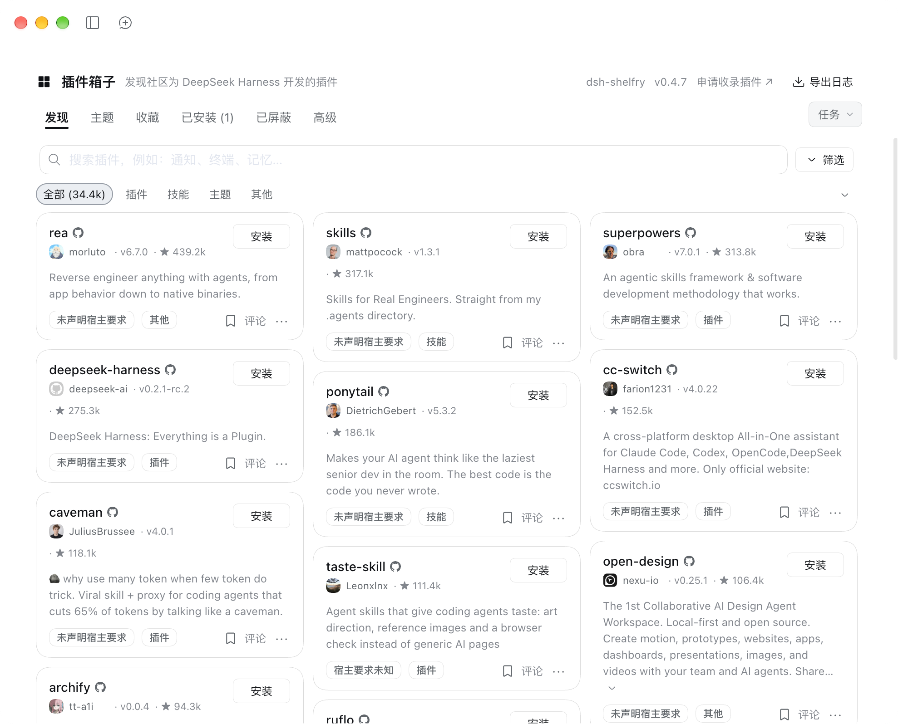
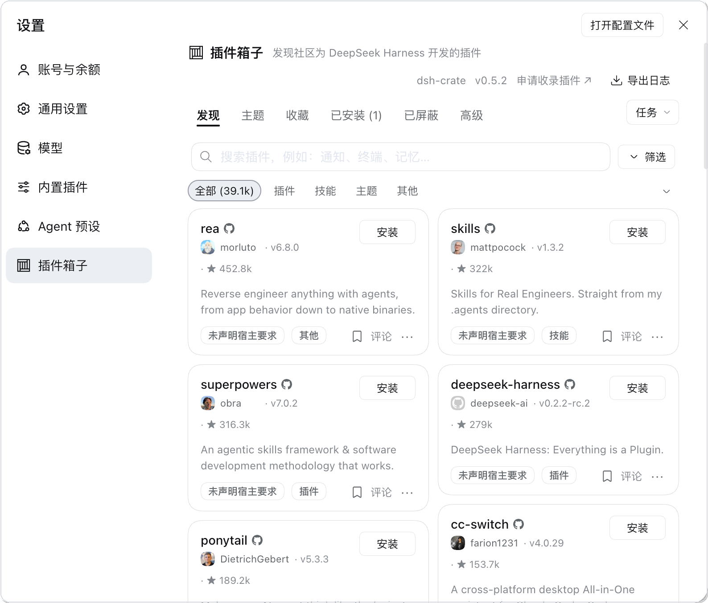

<p align="center">
  
</p>

# dsh-shelfry

[English](README.md) | 中文

**插件箱子**：装在 DeepSeek Harness 里的插件市场。不用离开 DSH，也不用去翻
GitHub 话题、辨认哪些仓库真能装、把安装命令手抄到终端——打开插件页，逛目录、
看简介，点一下装好。

dsh 0.2.1 起它是 **插件** 页上紧挨着 **已安装** 的一个页签；更早的宿主从
设置 → **Shelfry 市场** 进入。



## 为什么装它

DSH 的插件生态长得很快，找插件的方式却还停在「搜仓库 + 读 README + 抄命令」。
插件箱子把这段路收进一个界面：

- **一处浏览**：3 万+ 条收录，插件、Skill、主题、独立工具都在里面；
- **看得懂再装**：每条有简介、星标、更新时间与安装方式，卡片上能看截图和讨论；
- **装完就在手边**：安装、更新、卸载、启停、分组都在同一页完成，不用来回切终端。

## 功能

**逛与找**

- 全量目录搜索，可按分类筛选、按星标排序
- 简介跟随界面语言，中英文都能读
- 卡片带截图与讨论区，主题类条目能看到实际效果

**装与管**

- 一键安装，实时显示下载与构建进度
- 逐插件检查更新，附「更新内容」链接直达变更说明
- 收藏、分组、每个插件一行备注；分组可以整体开关
- 卸载、热启用/停用；改动不能热加载时提供一键重启

**稳与恢复**

- 中国大陆地区可切换 GitHub 下载线路
- 启动失败后的「调整插件」恢复页，一次坏配置不至于把界面锁死
- 查看加载顺序与冲突的诊断页、脱敏日志导出
- 备份与恢复：本地 JSON、WebDAV、私有 GitHub Gist

**设置**

- 下载地区、GitHub 加速、更新通道、入口位置、构建环境都在界面里改
- 有专门的设置卡片管理市场自身；`allowRestart`、`buildEnv` 也可写进 profile 配置

## 主题

装好的主题不用重启就能生效，配色即时切换：



## 来源与声明

本项目**不是原创**，而是 dsh-market 的衍生修改版：
[dsh-market](https://github.com/dsh-market/dsh-market)，作者 fkysly 及其贡献者。
目录数据由本站 **shelfry** 独立维护，规模与覆盖范围跟原版不是同一份数据。

我们在上游基础上做的改动：

- 目录数据换成本站 shelfry 的收录结果：条目更多（当前 3 万+，每日自动更新），
  并补充了分类、主题、评分与中英文简介；
- 按 shelfry 的数据结构重写了目录读取与映射，界面与交互随之调整；
- 新增了主题类目，并适配评分、分类等字段；
- 其余功能基本沿用上游实现。

上游以 MIT 许可发布，原始版权声明已按许可要求保留在 [LICENSE](LICENSE)。
在此向上游作者与贡献者致谢——没有他们的工作，就没有这个插件。若上游作者对
本次衍生使用有异议，请在 issue 中说明，我们会配合处理。

## 安装

推荐从 npm 安装：

```sh
dsh plugin --profile web add dsh-shelfry
```

也可以直接从仓库安装，未正式发布的改动会先出现在这里：

```sh
dsh plugin --profile web add github:shelfry/dsh-shelfry
```

装完重启 `dsh web`。profile 不是 `web` 的话换个名字，两条命令同理：

```sh
dsh plugin --profile <profile> add dsh-shelfry
dsh plugin --profile <profile> add github:shelfry/dsh-shelfry
```

从 git 源安装时，pnpm 会先问是否允许运行构建脚本。`client/client.js` 已经
随仓库提交，所以市场本身不需要构建；也可以把预构建的 tarball 挂到 release
上走那条路。

装了 DSH 桌面端的机器上，`dsh plugin --profile web` 装进的是
`profiles/web`，**不是**桌面端在用的那个 profile。这种情况请用应用里的
**设置 → 插件** 安装。

安装顺序：仓库校验过的 npm 包优先，其次是作者预构建的 GitHub Release
tarball，最后才是整仓库源码。构建脚本默认被拦住（pnpm ≥10），放行需要你针对
单个包明确同意。

## 配置

所有设置都在 profile 的 `cordis.patch.yml` 的 `config:` 下面——加载器只把
这个子对象传给插件，写在顶层的键会被静默忽略：

```yaml
- id: dsh-shelfry
  name: 'dsh-shelfry'
  config:
    allowRestart: false   # 隐藏重启按钮（systemd / pm2 / launchd）
    buildEnv:
      CC: /usr/bin/gcc-11
      CXX: /usr/bin/g++-11
```

- `allowRestart` —— 本进程是 systemd 的服务主进程时，重启按钮会自动隐藏；
  pm2 和 launchd 检测不到，这些部署要手动设这一项。
- `buildEnv` —— 市场拉起的每个进程（安装、编译、git）的环境变量。`PATH` 和
  `CI` 由市场自己管理，不能覆盖。
- `DSHM_GITHUB_PROXY` —— 运营方持有的 GitHub 加速前缀；设了它，界面里的对应
  输入框会变成只读。

其余大部分在界面里改：下载地区、GitHub 加速、更新通道、入口（侧栏 / 设置 /
插件页签）、构建环境、收藏、分组，以及每个插件的一行备注。

## 开发

```sh
npm install
npm run typecheck   # 宿主、客户端、测试三份
npm test            # vitest，3000+ 用例
npm run build       # lib/ 与 client/client.js
```

`client/client.js` 是提交进仓库的产物：改了源码要重新构建并一起提交。
`scripts/preflight.mjs`（由 `prepack` 触发）会检查这个文件里的 loader id 与
`package.json` 一致、`cordis.patch.yml` 按同一个名字插入，以及声明的图标有没有
打进去。

浏览器产物以 `window.__ModuleLoader__.load({ id })` 注册自己，id 必须等于包名
——不一致就一个界面都加载不出来。

代码规范见 [TESTING.md](TESTING.md)，安全边界见 [SECURITY.md](SECURITY.md)。

## 许可

MIT。本项目是 dsh-market 的衍生修改版，原始版权声明保留在
[LICENSE](LICENSE)。
